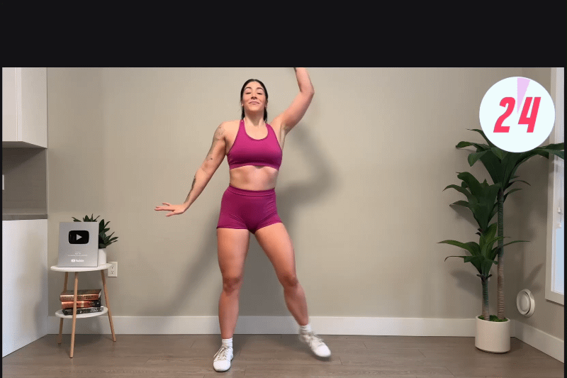
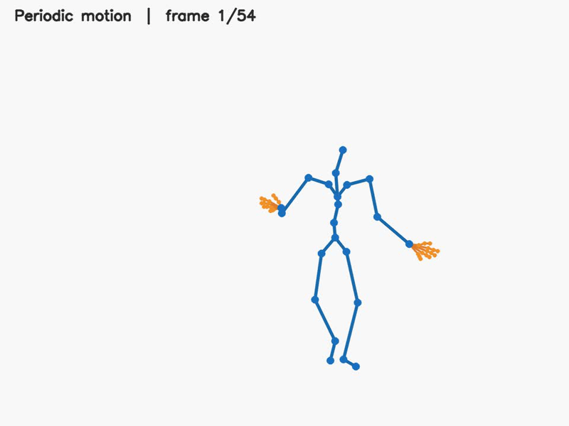
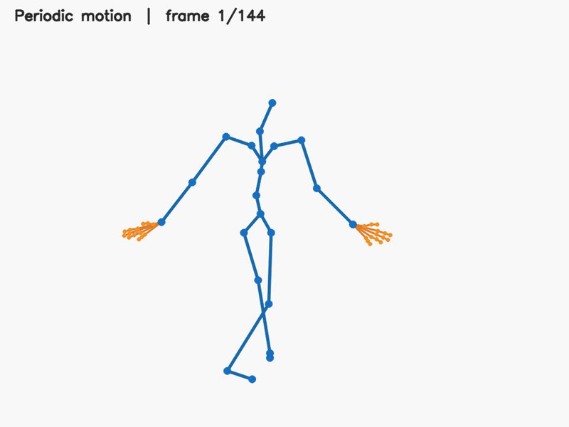
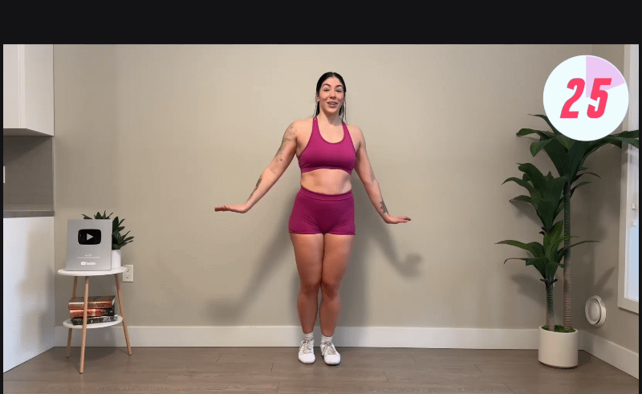

# 原子动作周期切分

## 1. GLB 到 52 关节

动作周期分析的输入是 `world4d.glb` 和对应的 `results.pkl`，不是原始视频像素。GLB 解析器读取 glTF 节点名称、父子骨骼层级和逐帧 translation/rotation/scale 动画通道，计算每个关节的世界坐标。

部分 SMPL 文件只有 22 个身体关节，因此优先使用包含身体和手部层级的 GLB，统一得到 52 个关节：22 个身体关节，加左右手各 15 个关节。输出 `joints_52.npy`，形状为 `[T,52,3]`，坐标采用 GLB 世界坐标、Y-up。周期分析随后使用相对于骨盆的局部运动，减少人物整体平移的影响。

## 2. 623 维 Tomato 表示

使用 HumanTOMATO 原始 `process_file()` 做尺度统一、地面校正、根节点归一化、朝向归一化、逆运动学和特征拼接：

| 子特征 | 维度 | 含义 |
|---|---:|---|
| 根节点运动 | 4 | 根旋转速度、XZ 平移速度、根高度 |
| 局部关节位置 | 153 | 51 个非根关节的局部位置 |
| 连续 6D 旋转 | 306 | 51 个非根关节的连续旋转 |
| 局部速度 | 156 | 52 个关节的三维速度 |
| 脚部接触 | 4 | 左右脚接触特征 |
| 合计 | **623** | `4+153+306+156+4` |

由于速度按相邻帧差分，`T` 个关节帧对应 `T-1` 行 Tomato 特征，保存为 `tomato_623.npy`。

## 3. 基础周期 P

周期检测选取左右膝、左右脚、左右肘、左右手腕，共 8 个关节、24 个 XYZ 信号。先计算骨盆相对位置：

$$
r_j(t)=p_j(t)-p_{pelvis}(t)
$$

再做轻微平滑和一阶差分：

$$
d_j(t)=r_j(t)-r_j(t-1)
$$

每个信号去均值并做 L2 归一化，避免单个大幅度关节支配结果。对延迟 `τ`，单个信号的自相关为：

$$
C_m(\tau)=\sum_t \hat{x}_m(t)\hat{x}_m(t+\tau)
$$

对 24 个信号求平均：

$$
C(\tau)=\frac{1}{24}\sum_{m=1}^{24}C_m(\tau)
$$

平均自相关峰值给出基础周期 `P`。它表示最短重复节拍，不一定是完整左右动作周期。例如左右交替动作可能每 72 帧出现一次基础节拍，但要经过多个基础块才回到同一左右结构。

## 4. 复合周期 K×P

基础周期不能直接等于原子动作，因此增加第二层复合周期搜索：

1. 固定视频第 0 帧为候选起点；
2. 按 `P` 将视频划分为动作块 `B_0,B_1,...`；
3. 为动作块提取相对骨盆位置、速度、左右关节和镜像描述；
4. 测试 `K=1,2,3,...` 的候选周期 `L=K×P`；
5. 比较相隔 `K` 个基础块的重复误差和阶段顺序；
6. 检查周期首尾是否回到相近状态，避免边界落在动作半程；
7. 检查左右结构是否完整，保留原始左右顺序；
8. 选择重复误差较小、闭合较好且结构完整的最小 `K`，按 `0:L:2L:3L...` 切分。

例如基础块序列 `A A B C A A B C` 的完整原子周期可能是 `4P`；`A A B A A B` 可能是 `3P`。单侧重复只能作为子周期证据，不能把左侧或右侧局部重复直接输出为完整原子动作。这里的 `A/B/C` 是运动学模式，不是“抬腿”“挥臂”等语义类别。

## 5. 周期诊断与限制

每个片段保存 `period_diagnostic.png`，包含关节运动曲线、基础周期内部边界、最终复合周期边界、多关节平均自相关曲线，以及不同 `K` 的动作块重复误差。算法还会过滤运动幅度很低的静止重复尾帧，并记录基础周期、复合倍数、起止帧和候选误差。

`clip_002` 的基础周期为 `P=72` 帧，最终复合周期为 `288` 帧，即 `K=4`。如果直接按 72 帧切分，可能把左右动作或多阶段动作拆开；288 帧覆盖了完整基础块组合。

只有一次完整左右组合、缺少第二次重复证据的短视频，应保留候选并标记为需要复核，不能把一次观察结果伪装成高置信度周期。
