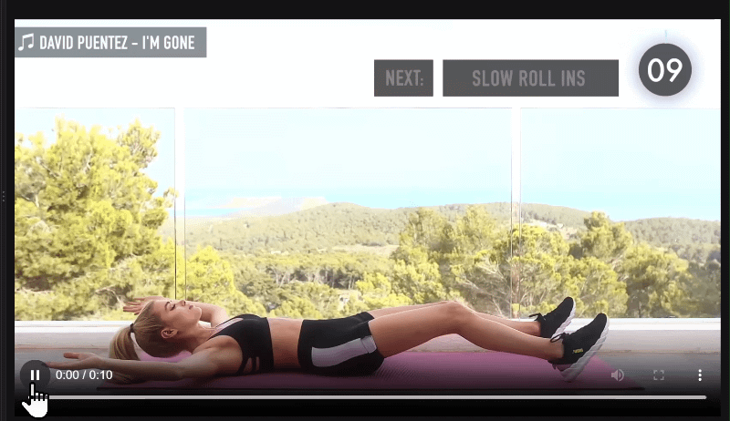
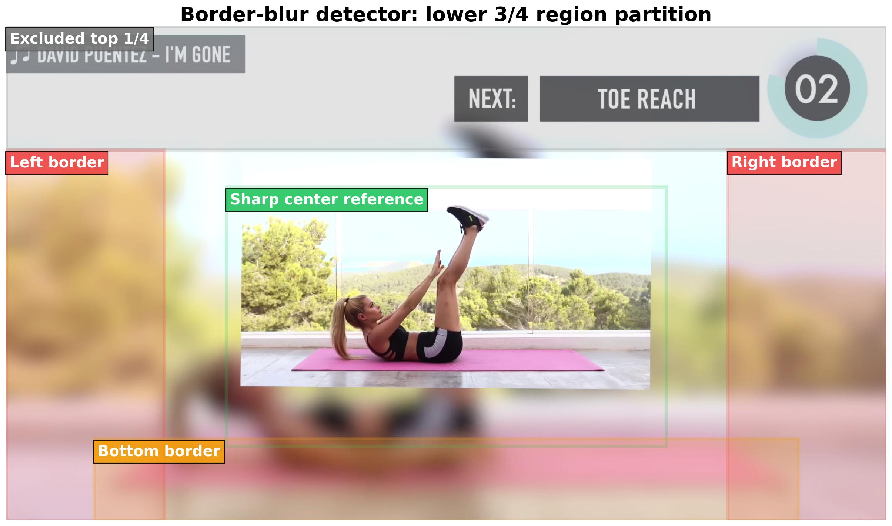
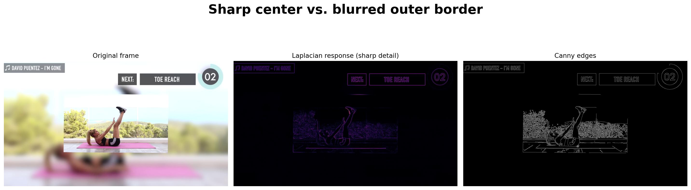

# 四周虚化专项检测

## 1. 为什么增加专项检测



四周虚化通常表现为“中央主体仍清晰，左右和底部被明显平滑”，有时还伴随中央画面缩小。它可能持续很多帧，但人物和背景语义变化不大，所以通用 ShotChange 模型不一定生成新的镜头区间。专项检测直接检查这种空间结构。

## 2. 区域划分与指标

每帧先忽略顶部四分之一，减少倒计时、标题和字幕影响；下方四分之三区域划分为中央主体、左右边框和底部边框。中央宽度约 50%，左右边框各约 18%，底部边框约占下方区域的 22%。计算前将画面等比例缩放至宽度 320 像素。

对灰度图计算拉普拉斯清晰度：

```text
L_center = Var(Laplacian(center))
L_border = 左、右、底部区域拉普拉斯方差的面积加权平均
R_lap = L_border / L_center
```

清晰区域包含更多高频细节，拉普拉斯方差较高；外围虚化后方差降低。当前要求 `R_lap <= 0.08`。

再计算 Canny 边缘密度：

```text
E_center = 中央区域边缘像素比例
E_border = 边框区域边缘密度的面积加权平均
R_edge = E_border / E_center
```

当前要求 `R_edge <= 0.15`，并要求中央清晰度 `L_center >= 100`，避免把全画面失焦、黑场或纯色画面判断成四周虚化。





## 3. 时间合并与输出

一帧只有同时满足以下条件才判为阳性：

```text
R_lap <= 0.08
且 R_edge <= 0.15
且 L_center >= 100
```

全量任务每 5 帧采样一次。阳性采样点按时间顺序合并，中间允许缺失一个采样点，以避免短暂遮挡或噪声拆断连续区间；持续时间小于 0.40 秒的片段被过滤。最终输出半开区间 `[start_frame, end_frame)`、`blur_score`、阳性采样数、采样总数、FPS 和阈值版本。

## 4. 回归结果与融合

在 `MmNbGJS57U8` 中，原先 OmniShotCut 不稳定识别的 `_003、_005、_007、_009` 全部检出，虚化区间均为 `[23,228)`，25 FPS 下约为 0.92–9.12 秒，`blur_score=0.8039`；相邻普通全画面片段未被误报。

全量扫描范围为 9,430 个视频。文档生成阶段已处理 452 个、输出 11 个阳性，仍是阶段性进度。结果文件只写入阳性视频，不能用 JSONL 行数代表全量处理进度。

最终保留 OmniShotCut 的通用边界和虚化检测的 `blur_segments`，按帧号合并相近候选、去重并抽样复核。专项检测可能受到中央区域偏移、边框字幕、天然低纹理背景和过短虚化片段影响，因此它判断的是视觉结构，不单独证明发生了摄像机位姿变化。
