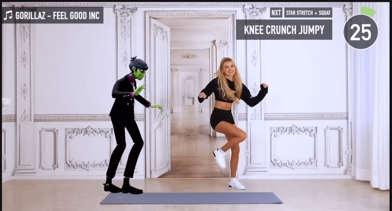
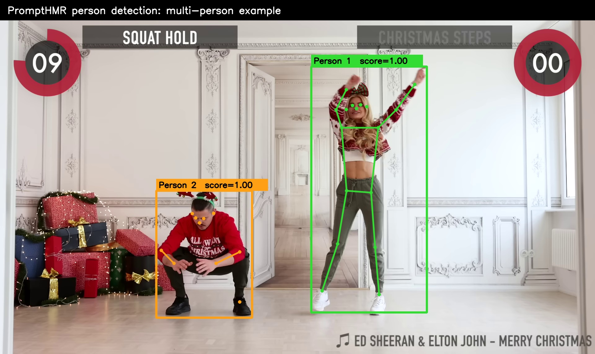
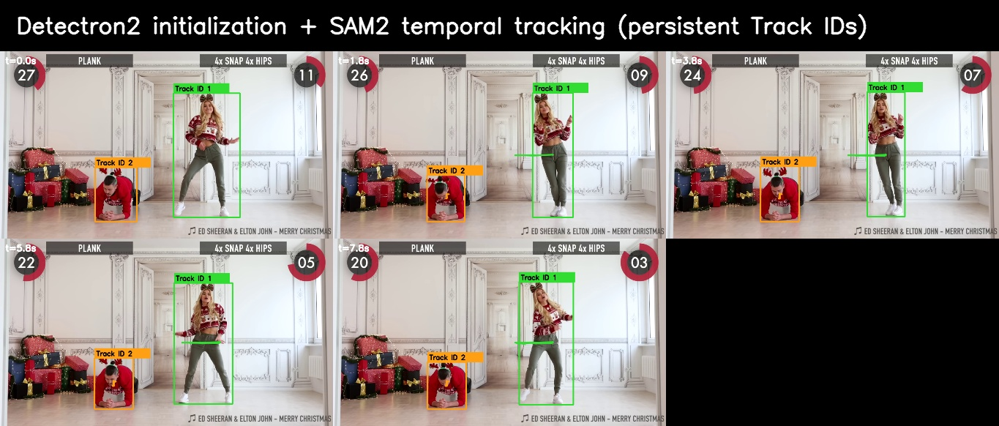

# 多人检测与轨迹去重



## 1. 为什么不能只数检测框

最初的问题是，人体检测框或跟踪 ID 的数量不等于真实人物数量。平躺、侧身、局部遮挡时，同一个人可能被检测器拆成两个候选人体；画面切换后，SAM2 也可能丢失原轨迹并重新建立一条轨迹。若直接把轨迹数量当成人数，会把单人片段错误标成多人。

## 2. 检测流程

```text
视频采样
    ↓
Detectron2 Keypoint R-CNN 生成候选人体
    ↓
OKS-NMS 去除重复候选
    ↓
面积、检测分数和人体高度过滤
    ↓
SAM2 为候选建立独立人物轨迹
    ↓
清理无效帧和过短轨迹
    ↓
ViTPose 验证 2D 姿态
    ↓
PromptHMR 图像模型 + PRHMR-Vid 时序验证
    ↓
统计有效人物轨迹数量
```

Detectron2 输出人体框、17 个 COCO 关键点及置信度；OKS-NMS 当前阈值为 0.5，依据关键点布局相似性去重。SAM2 对每个保留候选建立独立 object，沿时间传播 mask 和 bbox。ViTPose 要求关键点形状、数值有效且轨迹至少保留 5 帧；只有成功生成 `smplx_cam` 的轨迹才计为 HMR 有效轨迹。





## 3. 判定规则

视频段级别使用：

```text
hmr_valid_tracks >= 2
```

文件夹级别采用更严格的双段规则：选定的两个视频段都必须满足多人条件。

```text
[2,2] → 文件夹标记为多人
[2,1]、[1,2]、[1,1] → 不标记为多人
```

这样可以降低单个视频段的偶然误检对整组数据的影响。

## 4. 两级重复轨迹去重

HMR 能判断一条轨迹是否像一个人，但不能直接判断两条轨迹是否属于同一个人，因此增加固定镜头下的两级去重：

1. HMR 前比较 bbox/mask IoU、包含关系、中心距离、运动差异和共同帧覆盖；满足空间与运动条件时保留更长、平均框更大的轨迹；
2. HMR 后比较 ViTPose 关键点、相对人体框的归一化误差、HMR 身体形状 `betas` 和轨迹长度，合并高度一致的重复轨迹。

在 `Medium Level/064` 和 `Stretching/005` 的实验中，两级去重没有把原来的 `[2,1]` 改成单人结果，说明两条轨迹在当前阈值下并不满足合并条件。当前结果应理解为“经过时序和 HMR 验证的多人候选”，而不是已经完成身份级去重。

## 5. 对动作切分的作用

单人片段进入单人 HMR；中央多人保留全部人体序列并比较周期质量；侧边背景人物可先提取中央主人物，轨迹不稳时再回退多人模式；关键点不足或严重遮挡则进入人工复核。质量标签在周期分析之前生效，避免人数误判被传递成动作周期错误。
