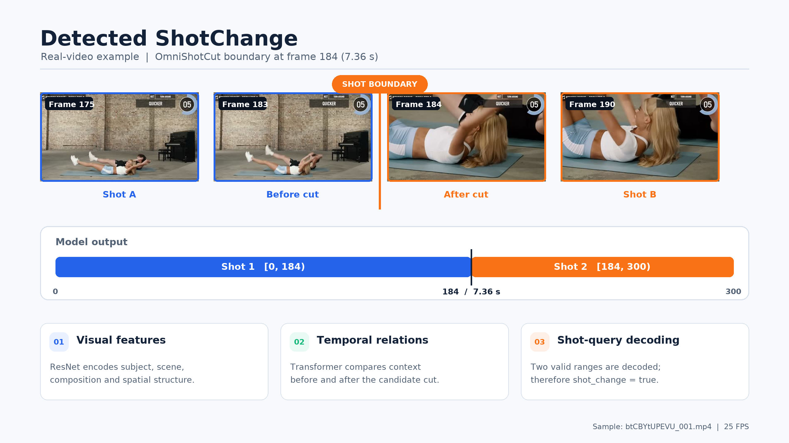

# ShotChange 镜头边界检测

## 1. 检测目标

ShotChange 的目标是把视频划分为若干个时空上连续的 shot，并定位 shot 之间的边界。它不是简单判断相邻两帧是否变化很大，而是对一个时间窗口整体回答：窗口中包含几个连续镜头、每个镜头在哪里结束、镜头之间是什么关系。

同一镜头中的快速动作、甩镜、闪光和字幕都可能造成大帧差；溶解、淡入淡出、模糊和缩放转场又可能让相邻帧变化很小。因此需要同时观察边界前、边界中和边界后的时间上下文。


## 2. 使用的模型与基本流程

本项目使用 OmniShotCut，一种基于 Shot Query Transformer 的通用镜头边界检测模型。它不是逐帧比较像素差，而是把一段视频作为一个时间窗口整体建模。

```text
视频解码与预处理
    ↓
按重叠时间窗口输入模型
    ↓
ResNet 提取每帧空间视觉特征
    ↓
Transformer Encoder 建模前后帧的时空关系
    ↓
Shot Query 查询窗口内可能存在的镜头区间
    ↓
预测镜头终点、镜头内部形式和镜头间关系
    ↓
解码为连续镜头区间并合并重叠窗口结果
```

ResNet 负责提取人物、背景和画面构图等视觉特征；Transformer 负责判断这些特征在时间上是连续变化，还是发生硬切、渐变转场或突然跳变；Shot Query 直接给出候选镜头的结束位置，并辅助判断普通镜头、硬切和转场关系。

## 3. 输出与使用方式

模型将窗口预测转换成 `pred_ranges`。例如：

```json
[[0, 2], [2, 26], [26, 251]]
```

表示第 2 帧和第 26 帧附近出现镜头边界；如果输出只有 `[[0, 251]]`，表示没有检测到有效 ShotChange。长视频的多个窗口结果会映射回原始帧号、排序并去重，得到全视频边界。



确认边界后，先在边界处分割，再对各子段分别运行 HMR 和原子周期检测，禁止跨镜头寻找一个“完整周期”。

## 4. 方法边界

OmniShotCut 对一般硬切和多帧转场有效，但对中央主体和语义基本不变、变化集中在外围的弱虚化可能漏检。因此四周虚化需要作为独立专项检测通道，与通用镜头边界结果进行融合。
