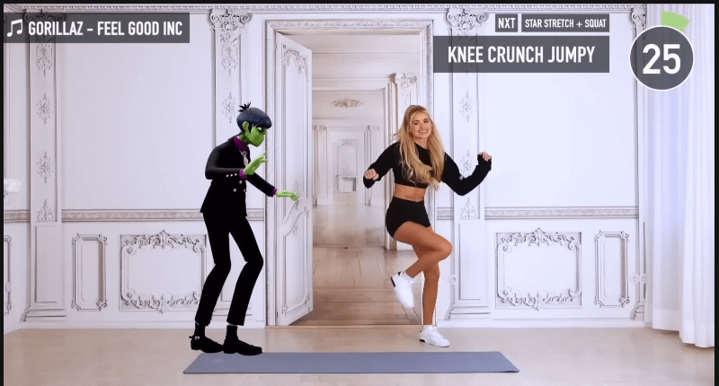
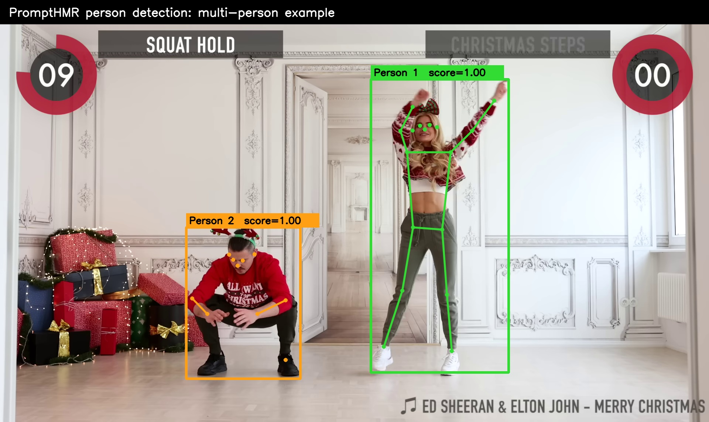
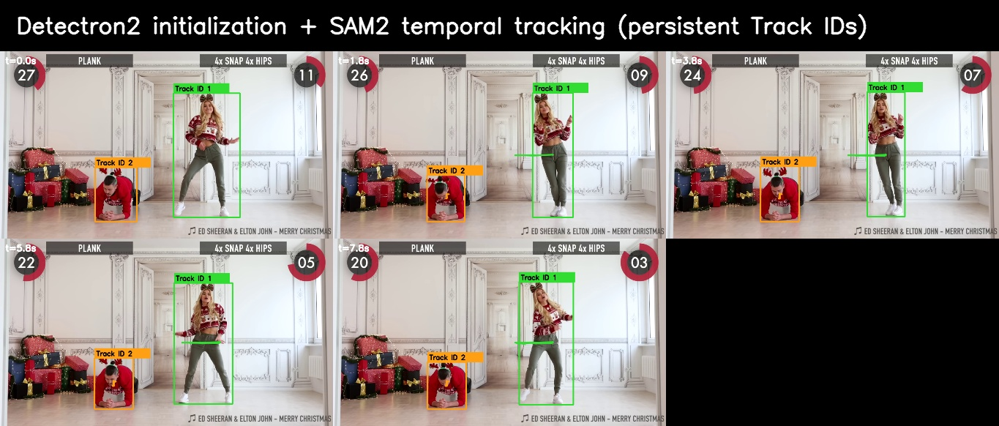
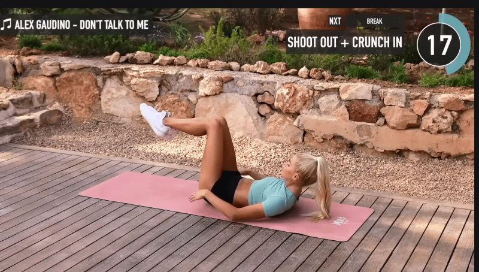
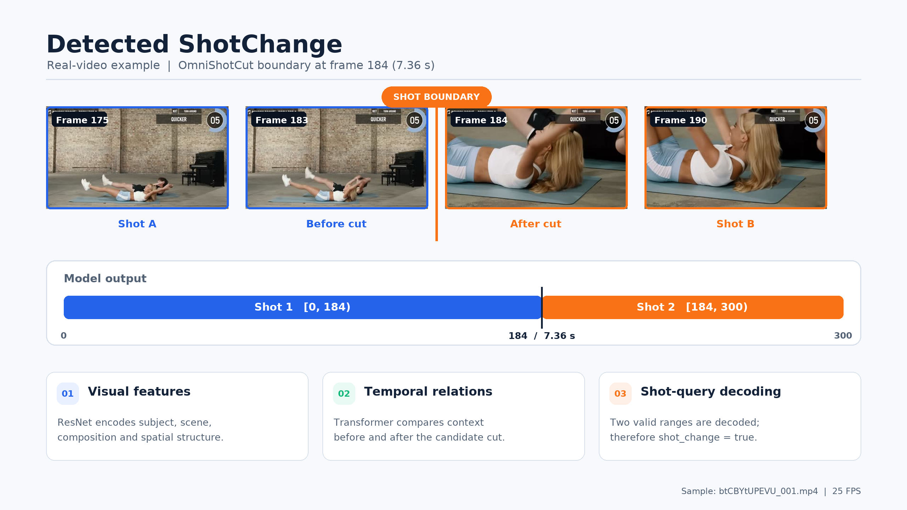
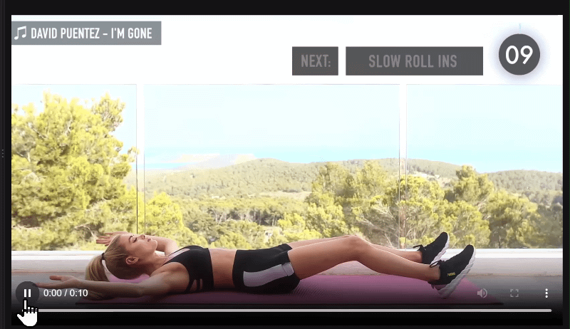
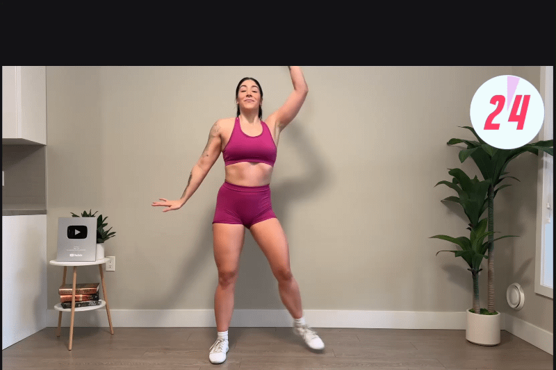
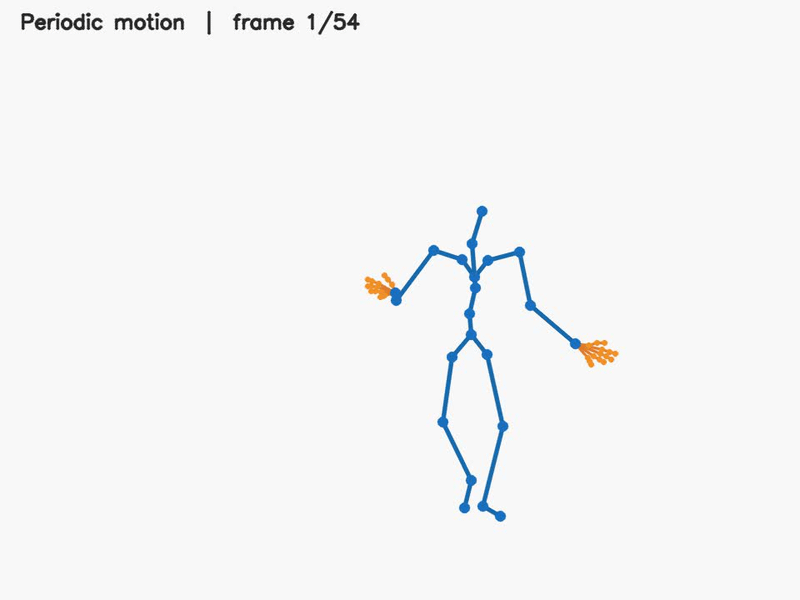
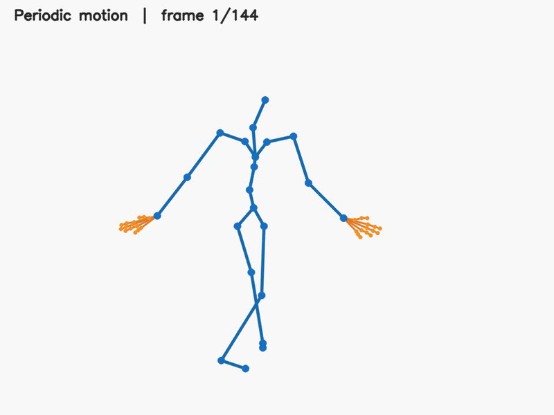
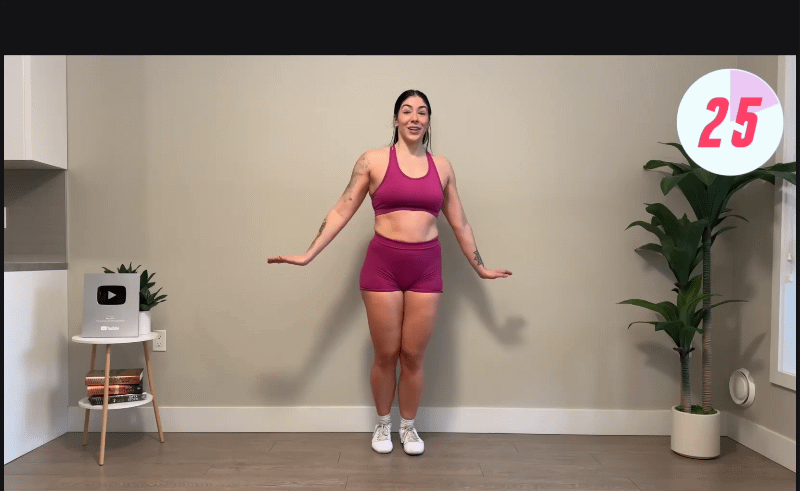

# 原子动作切分综合汇报

汇报依据：2026-10-31 至 2026-11-02 的多人检测、镜头边界检测、四周虚化检测和 Tomato/AMASS 动作切分材料；本次为 2026-11-02 第三次汇报。

## 一、先回顾上周：原子动作切分前的三类输入问题

上周的问题并不完全来自“周期算法本身”，更早暴露在视频质量和人体轨迹输入上。三类问题都会直接破坏后续 HMR 和周期分析，因此处理顺序应是：先做输入质量控制，再重跑 HMR，最后寻找完整动作周期。

| 问题类型 | 典型现象 | 对原子动作切分的影响 | 基本处理原则 |
|---|---|---|---|
| 双人/多人 | 画面中出现两个人，或一个人平躺、侧身、遮挡后被检测成两个候选人体 | 单人 HMR 可能跟错人，骨架序列发生跳变，周期被截断或拼接错误 | 先确认真实人物数量；多人保留独立人体序列，重复轨迹需要进一步去重 |
| Shot change | 同一视频段内发生硬切、渐进转场或视角突变 | 不同镜头的人体框和关键点被拼进一条轨迹，周期边界失真 | 先检测并切开镜头边界，各子段分别运行 HMR，不跨镜头找周期 |
| 中央画面边界虚化/缩小预告 | 完整人物变成中央小画面，外围虚化，通常持续数秒后才进入完整动作 | 人体尺度、清晰度和关键点分布突然改变，容易生成错误 HMR 或错误周期 | 标记并排除预告区间，保留后续正常画面重新做周期分析，不能把完整动作一并删除 |

这三类问题的共同点是：它们会制造“看起来像动作变化、实际上是输入状态变化”的假周期。质量控制不能只依赖单帧人体框，也不能把所有异常都归咎于原子动作算法。

## 二、目前形成的完整处理链路

现在的链路可以统一为：

```text
视频筛选与质量标记
    ↓
倒计时切成 exercise segment
    ↓
多人、镜头边界、四周虚化专项检测
    ↓
按质量标签选择 GVHMR 或 PromptHMR，多人/异常片段必要时重跑
    ↓
GLB 解析为 52 关节轨迹
    ↓
HumanTOMATO 623 维表示
    ↓
基础周期 P 检测 + 复合周期 K×P 搜索
    ↓
选择完整、稳定、可重复的原子动作周期
    ↓
导出 Tomato、AMASS 风格 SMPL-X、Blender 关节动画及诊断结果
```

这里要区分两个层次：视频切片是把长视频拆成 exercise segment；原子动作是 segment 内进一步找到一个完整、稳定、可解释的运动周期。一个 30 秒左右的 segment 不自动等于一个原子动作。

## 三、多人检测：先解决“到底有几个人”



### 3.1 判定规则与检测链路

当前多人检测脚本将 Detectron2、OKS-NMS、SAM2、ViTPose、PromptHMR/PRHMR-Vid 串成一条时序验证链：

```text
视频采样
 → Detectron2 人体候选
 → OKS-NMS 去重
 → 面积/分数/高度过滤
 → SAM2 建立人物轨迹
 → 轨迹清理
 → ViTPose 2D 姿态验证
 → PromptHMR 图像特征与 PRHMR-Vid 时序验证
 → 统计有效人物轨迹
```

 `hmr_valid_tracks >= 2` 作为多人候选。





### 3.2 误检来源与去重实验

平躺、侧身和局部遮挡会让关键点布局不稳定；OKS-NMS 只按姿态相似性去重，躯干框和腿部框可能仍被保留为两个候选。Shot change 又可能使 SAM2 丢失原 mask，重新检测后产生第二条轨迹。最后，HMR 只能验证“每条轨迹像不像一个人”，不能判断两条轨迹是否属于同一个人。

因此增加了固定镜头下的两级重复轨迹去重：

1. HMR 前比较 bbox/mask IoU、包含关系、中心距离、运动差异和共同帧覆盖；
2. HMR 后比较 ViTPose 关键点、归一化误差、身体形状 `betas` 和轨迹长度。

## 四、ShotChange：避免跨镜头拼接人体轨迹

### 4.1 检测目标：边界不是“相邻两帧变化大”

ShotChange 的目标是把视频划分为若干个时空上连续的 shot，并定位 shot 之间的边界。模型是对一个时间窗口整体回答“窗口中包含几个连续镜头、每个镜头在哪里结束、镜头之间是什么关系”。



### 4.2 使用的模型与基本流程

本项目使用的是 OmniShotCut，一种基于 Shot Query Transformer 的通用镜头边界检测模型。它不是逐帧比较像素差，而是把一段视频作为一个时间窗口整体建模。

基本流程如下：

```text
视频解码与预处理
    ↓
按重叠时间窗口输入模型
    ↓
ResNet 提取每帧的空间视觉特征
    ↓
Transformer Encoder 建模前后帧的时空关系
    ↓
Shot Query 查询窗口内可能存在的镜头区间
    ↓
预测镜头终点、镜头内部形式和镜头间关系
    ↓
解码为连续镜头区间并合并重叠窗口结果
```

其中，ResNet 负责提取人物、背景和画面构图等视觉特征；Transformer 负责判断这些特征在时间上是连续变化，还是发生了硬切、渐变转场或突然跳变；Shot Query 则直接给出每个候选镜头的结束位置，并辅助判断是普通镜头、硬切还是转场。

最后，模型将窗口内的预测转换成 `pred_ranges`。例如 `[[0, 2], [2, 26], [26, 251]]` 表示视频在第 2 帧和第 26 帧附近出现镜头边界；如果输出只有 `[[0, 251]]`，则表示没有检测到有效的 ShotChange。长视频的多个窗口结果会映射回原始帧号、排序并去重，得到全视频的镜头边界。




## 五、四周虚化检测：补回通用模型容易漏掉的特殊视觉段落

### 5.1 为什么单独检测四周虚化



四周虚化通常表现为“中央主体仍清晰，左右和底部被明显平滑”，有时还伴随中央画面缩小。它可能持续很多帧、但主体和背景语义不变，所以通用 ShotChange 模型不一定把它解码为新的镜头区间。专项检测不依赖神经网络，而是直接检查这种空间结构。

### 5.2 画面区域与尺度

每帧先忽略顶部四分之一，避免倒计时、标题和字幕影响指标；下方四分之三区域再划分为：

```text
左侧边框约 18% | 中央清晰区域约 50% | 右侧边框约 18%
                 底部边框约 22%
```

左右边框和底部边框组成 `border` 区域，中央区域作为 `center`。计算前等比例缩放到宽度 320 像素，以降低全量扫描成本，同时保留边缘和纹理差异。

### 5.3 两个清晰度指标

对灰度图使用拉普拉斯算子。清晰区域包含更多高频边缘，拉普拉斯响应方差通常更高；虚化后细节被平滑，方差降低。定义：

```text
L_center = Var(Laplacian(center))
L_border = 左、右、底部区域拉普拉斯方差的面积加权平均
R_lap = L_border / L_center
```

如果外围比中央明显模糊，`R_lap` 会接近 0。当前阈值是 `R_lap <= 0.08`，即外围拉普拉斯清晰度不高于中央的约 8%。

单独使用拉普拉斯可能受压缩噪声、局部纹理和亮度影响，因此再计算 Canny 边缘密度：

```text
E_center = center 中边缘像素占比
E_border = 左、右、底部边缘像素的面积加权平均
R_edge = E_border / E_center
```

当前要求 `R_edge <= 0.15`，即边框有效边缘密度不高于中央的约 15%。

### 5.4 中央有效性与帧级联合判定

为了排除全画面失焦、黑场、纯色画面或中央本身没有细节的情况，还要求 `L_center >= 100`。一帧只有同时满足以下三个条件才是阳性：

```text
R_lap <= 0.08
且 R_edge <= 0.15
且 L_center >= 100
```

这三个条件分别回答：外围是否比中央模糊、外围边缘是否明显减少、中央是否仍然足够清晰。它们共同约束后，普通人物运动模糊、单帧压缩异常和字幕变化不容易单独触发检测。


## 六、原子动作周期切分：从基础节拍升级为复合周期

### 6.1 输入与 52 关节恢复

动作周期分析的输入不是视频像素，而是 HMR/Automic 产生的 `world4d.glb` 和对应的 `results.pkl`。GLB 解析器读取 glTF 节点名称、父子骨骼层级和逐帧 translation/rotation/scale 动画通道，计算每个关节的世界坐标。由于部分 SMPL 文件只有 22 个身体关节，当前优先使用包含身体和手部层级的 GLB，统一得到 52 个关节：22 个身体关节加左右手各 15 个关节。

输出 `joints_52.npy` 的形状为 `[T,52,3]`，坐标约定为 GLB 世界坐标、Y-up。后续周期分析使用相对于骨盆的局部运动，减少人物在场景中的整体平移对周期判断的影响。

### 6.2 623 维 Tomato 表示

使用 HumanTOMATO 的原始 `process_file()` 对骨架做尺度统一、地面校正、根节点归一化、朝向归一化、逆运动学和特征拼接。623 维具体由以下部分组成：

| 子特征 | 维度 | 计算含义 |
|---|---:|---|
| 根节点运动 | 4 | 根旋转速度 1、XZ 平移速度 2、根高度 1 |
| 局部关节位置 | 153 | 51 个非根关节的局部位置 |
| 连续 6D 旋转 | 306 | 51 个非根关节的连续旋转表示 |
| 局部速度 | 156 | 52 个关节的三维速度 |
| 脚部接触 | 4 | 左右脚接触特征 |
| 合计 | **623** | `4+153+306+156+4` |

由于速度按相邻帧差分，`T` 个关节帧对应 `T-1` 行 Tomato 特征，分别保存为 `tomato_623.npy`。

### 6.3 基础周期 P：用多关节运动信号找最短节拍

周期检测选取左右膝、左右脚、左右肘、左右手腕，共 8 个关节、24 个 XYZ 信号。对每个关节先计算骨盆相对位置：

$$
r_j(t)=p_j(t)-p_{pelvis}(t)
$$

然后做轻微平滑和一阶差分：

$$
d_j(t)=r_j(t)-r_j(t-1)
$$

这样获得的是“身体局部运动”而不是人物在画面中的整体位移。每个信号去均值并做 L2 归一化，避免幅度最大的单个关节或坐标轴支配结果。对延迟 `τ`，单个信号的自相关为：

$$
C_m(\tau)=\sum_t \hat{x}_m(t)\hat{x}_m(t+\tau)
$$

再对 24 个信号取平均：

$$
C(\tau)=\frac{1}{24}\sum_{m=1}^{24}C_m(\tau)
$$

平均自相关曲线的峰值提供基础周期 `P`。它回答的是“最短重复节拍大约隔多少帧”，而不是“完整的左右动作编排隔多少帧”。例如左右交替动作可能每 72 帧重复一次基础节拍，但必须经过 4 个基础块才回到同一左右结构。

算法同时保存 `period_scores.npy` 和诊断曲线，便于检查峰值是否由多个关节共同支持，而不是某一个关节的偶然波动。

### 6.4 复合周期 K×P：把基础节拍组合成完整原子动作

当前算法新增第二层复合周期搜索：

1. 固定视频第 0 帧为候选起点；
2. 按基础周期 `P` 把视频变成动作块序列 `B_0,B_1,...`；
3. 为每个动作块提取相对骨盆位置、速度、左右关节运动和镜像后的描述；
4. 对 `K=1,2,3,...` 的候选测试 `L=K×P`；
5. 比较相隔 `K` 个基础块的序列重复误差，检查候选周期内部阶段顺序是否一致；
6. 检查首尾是否回到相近运动状态，避免把周期边界放在动作半程；
7. 检查左右结构是否完整，同时保留原始左/右出现顺序；
8. 选择满足重复误差较小、闭合较好且结构完整的最小 `K`，再按 `0:L:2L:3L...` 切分。

这里的“重复”不是只比较一帧或一个关节，而是比较动作块的多关节位置、速度和左右模式。左右镜像距离只用于判断两个块是否属于同一运动学类型，不能把原始左、右顺序抹掉，也不能直接把动作命名成“抬腿”或“挥臂”。

例如基础块序列为：

```text
A A B C A A B C
```

则 `P` 可能只覆盖一个基础块，最终复合周期应为 `4P`；如果序列为 `A A B A A B`，则可能选择 `3P`。若左侧连续多次后再右侧连续多次，单侧重复只能作为子周期证据，完整左右组合才有资格成为最终原子周期。

### 6.5 周期段筛选、起止帧与诊断

视频第 0 帧固定为候选起点，周期边界不在视频中间任意漂移。算法会过滤运动幅度很低的静止重复尾帧，并记录最终周期的起止帧、周期数量、基础周期、复合倍数、候选误差和主周期段。

每个片段的 `period_diagnostic.png` 包含三层信息：

1. 关节运动曲线及动作段，绿色线表示最终复合周期边界，灰色点线表示基础周期内部边界；
2. 多关节平均自相关曲线，标出基础周期和复合周期；
3. 不同 `K` 的动作块重复误差，标出最终选择的 `K`。

因此，周期选择不仅有一个数值结果，还有可人工核查的“为什么选这个周期”的证据。只有一次完整组合、缺少第二次重复验证的短视频，应保留候选并标记为需要复核，而不能把它伪装成高置信度周期。








